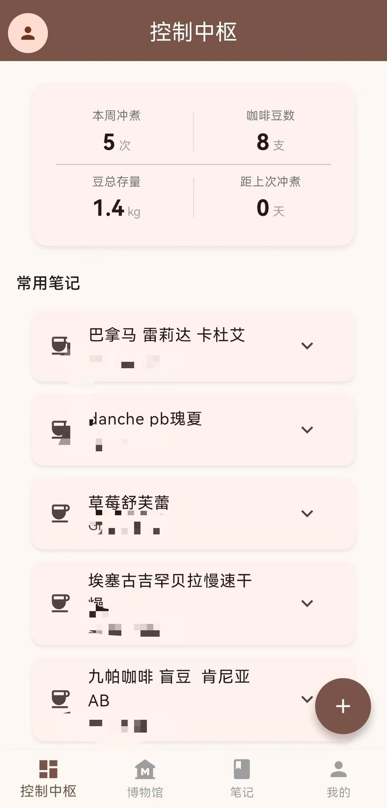
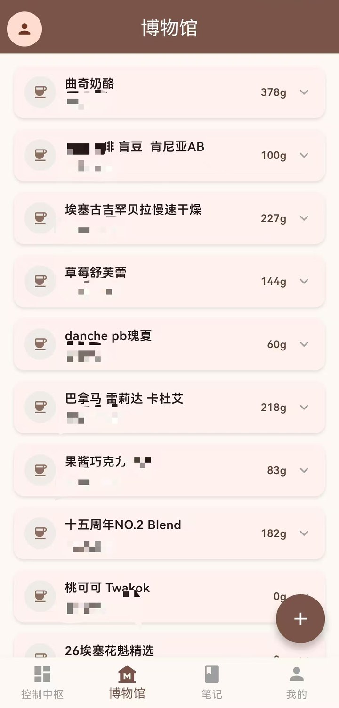
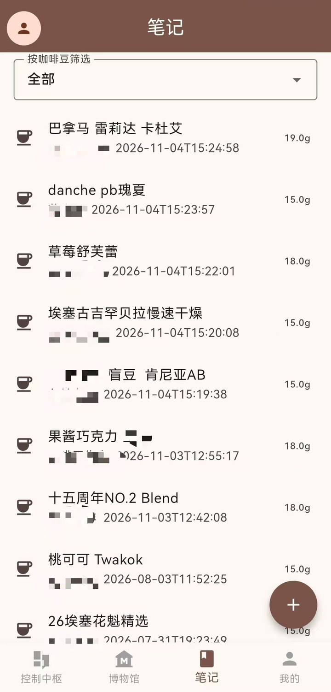
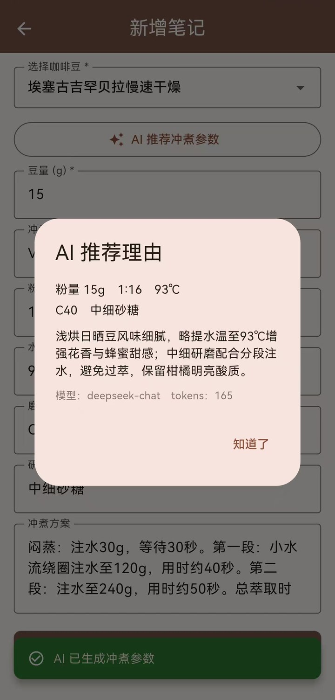

# 芋咖记 · YuCafe Note

> 记录每一支豆子，每一次冲煮。

面向个人咖啡爱好者的**咖啡豆档案 + 冲煮笔记**应用。移动端用 Flutter 写成，后端是 Spring Boot，
数据全部落在自己的服务器上——没有账号体系绑架，没有云端黑盒，代码完全开源可自建。

官网与下载：**https://cafenote.wutongcode.site**

---

**English** · A self-hosted coffee journal for home brewers. Keep the full profile of every bag of
beans (origin, estate, lot, altitude, variety, process, roast level, cupping score, stock, price),
log every brew, and know when each bag is at its best. Optional AI brewing suggestions via your own
DeepSeek key — the server never ships a shared key. Built with Flutter + GetX, backed by Spring Boot
and MySQL; no app store, no telemetry, data stays on infrastructure you control.

**[Website & APK download →](https://cafenote.wutongcode.site)**

<p align="center">
  
  
  
  
</p>

---

## 它解决什么问题

喝咖啡的人手里通常同时存在三样东西：一柜子豆子、一堆冲煮参数，和一个「上次那杯怎么冲的来着」。

市面上的 App 要么是计时器，要么是社交平台，要么要求你把数据交给它。

芋咖记只做一件事：**把你在这支豆子上试过的所有参数留下来，下次能原样复现，也能看得出进步。**

---

## 功能

### 咖啡豆档案

一支豆子的完整履历：产地、产区、庄园、批次、海拔、豆种、处理法、烘焙日期与烘焙度、
含水量、密度、水活性、色值(Agtron)、豆粉值、杯测风味与分数、生熟豆价格、库存克重、豆子照片。

字段虽多，但只有 5 个必填——不想记的可以留空，不会拦着你用。

### 赏味期提醒

按烘焙度推算这支豆子的排气期与最佳赏味窗口：

| 烘焙度 | 排气期 | 最佳赏味期 |
| --- | --- | --- |
| 浅烘 | 8 天 | 8–35 天 |
| 中烘 | 6 天 | 6–28 天 |
| 中深烘 | 5 天 | 5–24 天 |
| 深烘 | 4 天 | 4–20 天 |

列表上直接显示「排气中 · 还差 3 天」或「最佳赏味期 · 还剩 12 天」，详情页给完整说明。

### 冲煮笔记与「去冲煮」

笔记记录粉量、粉水比、水温、研磨度、器具与完整冲煮方案，可按豆子筛选。

点一下「去冲煮」会：写入一条冲煮记录 → 该笔记冲煮次数 +1 → 按本次豆量扣减咖啡豆库存 →
控制中枢的三项指标同步刷新。库存不够时不会报错，扣到 0 为止并在提示里说明。

### AI 冲煮建议

基于这支豆子的档案（产地、处理法、烘焙度、风味、杯测分）和历史冲煮记录，让模型给出一组参数，
一键回填到笔记表单。

实现上有三处克制：

- **用你自己的 DeepSeek Key**。App 不提供公共 Key，也就不存在「你的数据养别人的模型」。Key 在服务端用 AES-GCM 加密存储，界面上只回显后四位。
- **输出必须可解析**。请求带 `response_format=json_object`，服务端再按字段二次校验，粉量/粉水比/水温超出合理区间一律钳制（12–30g、1:12–1:18、85–96℃）。
- **失败要能降级**。模型超时或返回非法 JSON 时自动回退到内置规则模板（按烘焙度匹配），功能不中断，只是不那么聪明。

### 数据看板

本周冲煮次数、库存豆子数、总存量、距上次冲煮几天，以及最近常喝的几支笔记。

### 其它

- 亮色（咖啡棕 `#7A5448` + 奶油底）／暗色（Dracula）／跟随系统
- 图片磁盘缓存，同一张图只下载一次，重启 App 仍然命中
- 列表分页 + 滚动加载，豆子和笔记再多也不卡
- 骨架屏与图片渐显，不闪白、不空屏
- 长按多选、批量删除咖啡豆（级联删除关联笔记）

---

## 技术栈

| 层 | 选型 |
| --- | --- |
| 框架 | Flutter 3.44 / Dart 3.12 |
| 状态与路由 | GetX（业务控制器 + 全局导航控制器） |
| 网络 | Dio（统一请求层、token 静默续期、错误兜底） |
| 本地存储 | get_storage（token / 主题 / 字号） |
| 图片 | image_picker、cached_network_image + flutter_cache_manager |
| 后端 | Spring Boot 4 / Java 21 / MyBatis-Plus / MySQL 8 / JWT / DeepSeek |

---

## 目录结构

```
lib/
├── app/            应用入口、路由表、主题
├── controllers/    GetX 控制器（认证、豆子、笔记、看板、AI、导航）
├── models/         数据模型与 fromJson
├── services/       API 请求层（每个模块一个 service）
├── ui/
│   ├── auth/       登录、注册
│   ├── dashboard/  控制中枢
│   ├── museum/     咖啡豆列表与详情
│   ├── notes/      笔记列表与详情
│   ├── add/        新增/编辑咖啡豆、新增/编辑笔记
│   ├── profile/    我的、AI 管理、Token 用量、设置
│   └── widgets/    卡片、骨架屏、加载动画
└── utils/          常量、校验、图片、缓存、赏味期算法、提示
```

---

## 快速开始

### 1. 环境

- Flutter 3.35+（本项目在 3.44 验证）
- Android SDK（iOS 未做适配）

### 2. 准备后端

App 需要一个后端实例（Spring Boot 4 + Java 21 + MySQL 8 + JWT）。

**后端代码暂未开源**。需要的话可以开 issue 或邮件联系；如果你只想先看界面，
把 `API_BASE_URL` 指向任意返回相同 JSON 结构的服务也能跑通（统一响应格式为
`{ code, message, data }`，鉴权走 `Authorization: Bearer <token>`）。

### 3. 跑起来

```bash
flutter pub get
flutter run --dart-define=API_BASE_URL=http://10.0.2.2:8080/api
```

> `10.0.2.2` 是 Android 模拟器访问宿主机的地址；真机请换成电脑的局域网 IP。

### 4. 构建安装包

```bash
flutter build apk --release \
  --dart-define=API_BASE_URL=https://你的域名/api \
  --dart-define=IMAGE_BASE_URL=https://你的域名
```

签名配置放 `android/key.properties`（已在 `.gitignore` 中忽略），
模板见 `android/key.properties.example`。**不要把 jks 和 key.properties 提交到仓库。**

---

## AI 功能说明

AI 用的是 DeepSeek 的 OpenAI 兼容接口，**必须自己填 Key**：

1. 去 [platform.deepseek.com](https://platform.deepseek.com/api_keys) 申请
2. App 内「我的 → AI 管理 → DeepSeek 接入」填入
3. 回到「新增笔记 → 选好豆子 → AI 推荐冲煮参数」

不填也能用，只是没有 AI 建议——手填参数、看板、笔记这些核心功能完全不依赖它。

Key 只存在你自己的服务器上，服务端用 `YUCAFE_AI_SECRET` 派生的密钥做 AES-GCM 加密，
换了 secret 就得重新填（这是有意的）。

---

## 已知限制

- 只有 Android，iOS 没适配
- 没有上架应用商店，只发 GitHub Releases
- 后端按单用户单实例设计，没做多租户隔离压测
- 单元测试覆盖了赏味期算法和几个通用组件，其余靠手工回归

---

## 许可证

[MIT](LICENSE)
